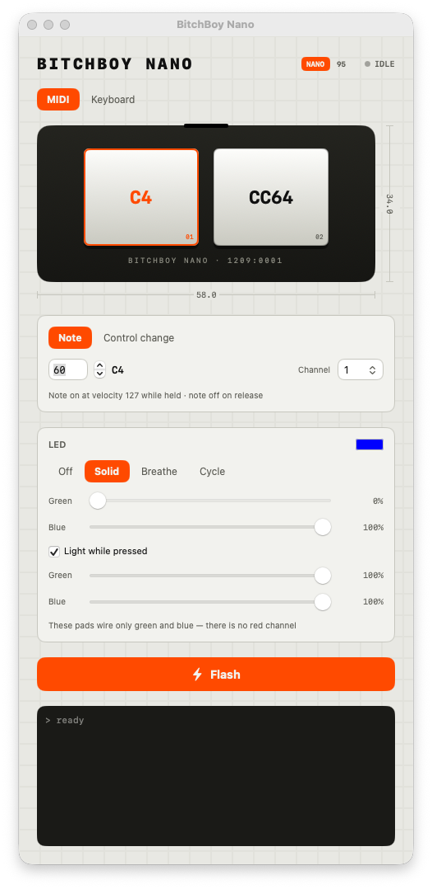
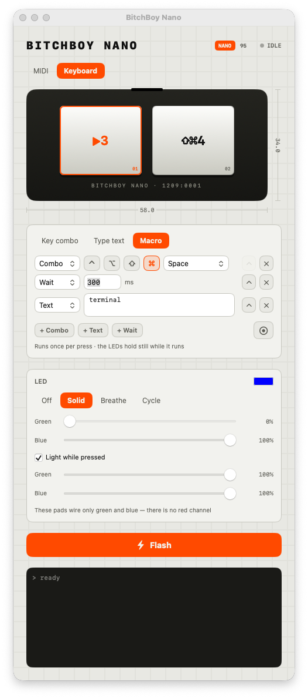
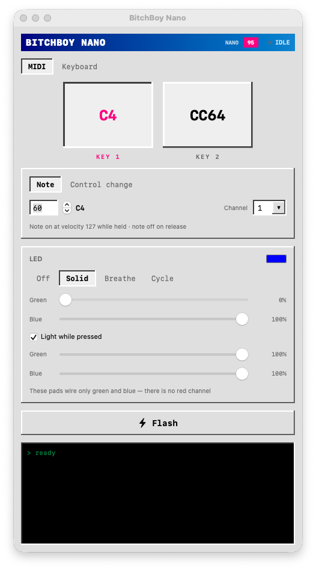

# BitchBoy Nano

GUI flasher that turns a cheap CH552G 2-key macropad (the "曾大大" pads from
[2button-pad-hack](https://github.com/chrisssstos/2button-pad-hack)) into a
class-compliant USB-MIDI controller — or, if you insist, a plain USB keyboard. Pick a
note or CC per button, or a key, a combo, a media key or a whole macro, and flash it.

**[Download the latest release](https://github.com/Afstkla/bitchboy-nano-flasher/releases/latest/download/BitchBoyNano.zip)**
— signed and notarized, macOS 13+, Apple silicon and Intel.

<p>
  
  
  
</p>

> **One-way:** the WCH bootloader cannot read flash, so the stock firmware cannot be
> backed up. The chip is unbrickable though — its bootloader is in mask ROM.

## Use

Open the app (or `swift run` from a checkout), configure both buttons, hit **Flash**, then put the pad in bootloader mode:

- **Already running this firmware?** Unplug, hold both buttons, plug back in.
- **Stock (or MIDI) firmware?** Bridge pin 12 (UDP) to pin 16 (V33) through a 10k
  resistor while plugging in, then remove it. Pinout and troubleshooting in the
  [2button-pad-hack README](https://github.com/chrisssstos/2button-pad-hack#getting-into-the-bootloader).

The flasher polls for the bootloader (`4348:55e0`) and flashes the instant it appears.
It talks to the chip over IOKit and patches the keymap into a precompiled image, so it
needs nothing installed — no compiler, no Python, no libusb. `brew install sdcc` is only
needed to rebuild `firmware/keypad.bin` after changing the firmware itself.

## MIDI mode

The default. The pad enumerates as a USB-MIDI device named **BitchBoy Nano** — no
drivers, no host software, works with any DAW, an iPad or a hardware synth. Per key:

- **Note** — note on at velocity 127 while held, note off on release.
- **Control change** — 127 on press, 0 on release. CC 64 on one key makes it a
  sustain pedal.

Each key picks its own MIDI channel. The USB-MIDI descriptor is the one from
[2button-pad-hack](https://github.com/chrisssstos/2button-pad-hack), unchanged apart
from the port name.

## Keyboard mode

The pad is either a MIDI device or a keyboard, never both at once, so a MIDI pad never
triggers macOS's keyboard setup assistant. In keyboard mode each button can be:

- **Key / combo** — held down for as long as the button is held: a letter, F1–F24,
  arrows, media keys, or a combo like ⌘⇧4. Modifiers are ignored for media keys.
  Hit the ⏺ record button and press the combo on your keyboard instead of picking it.
- **Text sequence** — typed once per press; newlines are sent as Enter. ASCII only
  (smart quotes and friends are folded back to ASCII automatically).
- **Macro** — a list of steps run once per press: combos, typed text, and waits in
  milliseconds. Hit ⏺ and just perform it — plain typing collects into one text step,
  anything with a modifier becomes a combo step, and any pause over 0.4s becomes a
  wait. Steps stay editable afterwards. The LEDs hold still while a macro runs.
- **LED** — per key: off, solid, breathe or cycle, with a speed and an optional
  separate colour while the key is held.

## Handing it to someone else

`./make-app.sh` builds a universal **BitchBoy Nano.app**, signs it with the Developer ID
cert, notarizes it and staples the ticket, leaving `build/BitchBoyNano.zip` to send. The
app is self-contained: whoever you send it to just opens it. Notarizing needs credentials
in the keychain once:

```sh
xcrun notarytool store-credentials bitchboy \
  --key ~/.appstoreconnect/private_keys/AuthKey_<key-id>.p8 \
  --key-id <key-id> --issuer <issuer-uuid>
```

The issuer UUID is on App Store Connect under Users and Access → Integrations. An
Apple ID plus `--password <app-specific-password>` works too, but an API key is
revocable on its own and does not hand a tool your Apple ID.

`./make-app.sh --no-notarize` skips that for local testing.

Releases are built the same way by `.github/workflows/release.yml`: push a tag like
`v1.1.0` and it signs, notarizes and attaches `BitchBoyNano.zip` to a GitHub release.
It needs the repo secrets `DEVELOPER_ID_P12` (base64), `DEVELOPER_ID_P12_PASSWORD`,
`NOTARY_KEY` (the `.p8` contents), `NOTARY_KEY_ID` and `NOTARY_ISSUER`.

## How a keymap gets onto the pad

The firmware reads what each key does out of a 512-byte blob in its own flash, rather
than having it compiled in. `firmware/keypad.bin` is committed with that blob empty but
marked by the magic `BBNKMAP`; flashing means finding the marker, splicing in the encoded
keymap, and writing the result. The layout is documented at the top of `firmware/keypad.c`
and encoded in `Keymap.swift` — `swift run Flasher --check` asserts the two agree.

Change the firmware itself and you need `brew install sdcc`, then `make -C firmware bin`,
and commit the new `keypad.bin`.

## The LEDs

Each key has an RGB die, but only two of its channels are wired. Found by sweeping
every pin against every other pin, and every pin against both rails:

| | anode | green | blue | red |
|---|---|---|---|---|
| Key 1 (left, `P3.2`) | `P1.7` | `P3.0` | `P3.1` | not reachable |
| Key 2 (right, `P1.4`) | `P1.1` | `P3.4` | `P3.3` | not reachable |

Both cathodes low at once gives cyan, so it's four states per key. None of these
share a pin with a switch, so the LEDs need no multiplexing against key scanning.

Red never lit in any configuration: all 90 ordered pin pairs, both rail directions on
all ten GPIOs, on two units, at full brightness in the dark. Listing photos do show
red, so it is presumably fitted on a backlit variant of the same PCB. `LED_BRIGHTNESS`
in `firmware/config.h` caps the duty cycle — the board's series resistors are unknown.

Two themes, switchable in the title bar: **NANO** (paper & signal orange, after
[bitchboynano.afstkla.nl](https://bitchboynano.afstkla.nl)) and **95** (Windows 95
silver, after [bitchboy.lol](https://bitchboy.lol)).

Key pins (`P32`/`P14`) and USB identity live in `firmware/config.h`. If your board's
switches sit on different pins, use the original repo's `PIN_DISCOVERY` firmware to
find them.

## Layout

```
Sources/Flasher/    SwiftUI app: keycap UI, keymap encoding, native CH55x flashing
stock.py            reconfigure a pad still on stock firmware, no bootloader needed
firmware/
  keypad.bin        precompiled image the app patches the keymap into
  config.h          pins, LEDs, USB identity
  keypad.c          key scanning, LEDs, keymap blob, bootloader entry
  src/              CH55x + USB HID/MIDI stack (vendored, wagiminator + chrisssstos)
docs/               screenshots
```

`swift run Flasher --check` verifies the keymap generation; `make -C firmware bin`
verifies the firmware still compiles.

## Credits

CH55x library, USB HID keyboard stack and `chprog.py` by **Stefan Wagner**
(wagiminator), from
[CH552-MacroPad-mini](https://github.com/wagiminator/CH552-MacroPad-mini), licensed
[CC BY-SA 3.0](http://creativecommons.org/licenses/by-sa/3.0/), which this project
keeps. Hardware reverse-engineering of the pad, and the USB-MIDI descriptor, from
[chrisssstos/2button-pad-hack](https://github.com/chrisssstos/2button-pad-hack).
